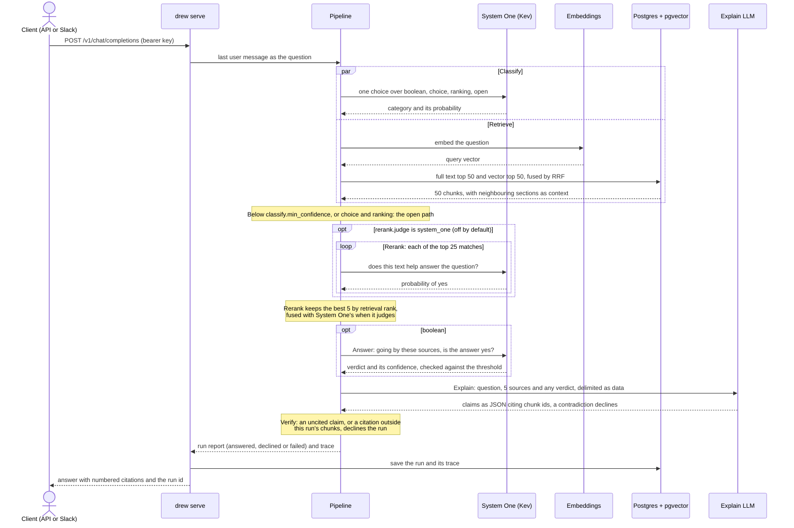

# Drew AI

Drew AI answers questions about SAP and ARM internals from **Drew Steinfatt's pre-audited markdown documentation**. Every answer cites its sources; when the sources don't support an answer, it declines instead of guessing.

It ships as a **developer-facing Slack bot** (Socket Mode, in `drew serve`) and an **OpenAI-compatible HTTP API**.

- [Design](docs/design.md): scope, pipeline model, evaluation, and milestones.
- [Architecture diagram](docs/archify/architecture.html): open it in a browser.

## Status

What works today:

- Batch ingestion of a markdown directory into Postgres with pgvector.
- Hybrid retrieval (full text + vectors, reciprocal rank fusion).
- Classify and Answer on a System One model ([Kev](https://github.com/jaredpalmer/kev)), with calibrated confidence scores; Rerank on it too when `rerank.judge` says so.
- The `open` path end to end: retrieve, rerank, explain with an LLM, verify every citation.
- OpenAI-compatible HTTP API, run persistence with full traces (trace on `GET /v1/runs/{id}`, not in chat responses).
- Optional Slack bot when `SLACK_APP_TOKEN` and `SLACK_BOT_TOKEN` are set.
- `drew eval`, and local, hosted (Cloudflare Workers AI) or Bedrock models; `drew models check` calls each one once.

Yes/no questions get a verdict: Kev answers yes or no over the reranked sources, the LLM explains why, and the run declines when the sources contradict the verdict or Kev is not confident enough. A classification below `classify.min_confidence` falls back to `open`.

Not built yet: Answer for `choice` and `ranking` (they take the `open` path); permission enforcement.

## How a question is answered

```
Classify ∥ Retrieve → Rerank → Explain → Verify
```



Each step is typed, so a pipeline with steps in the wrong order does not compile. Verify rejects any claim without a citation, or citing a chunk the run did not retrieve. Every run, including declines and failures, is stored with a trace of each step's model, prompt version, score, and raw output.

## Latest evaluation

The benchmark is the DaaS golden set (`eval/golden/daas.jsonl`, 58 questions), run on 2026-10-19 at `e35960e` with local models: `bge-m3` embeddings, Kev 4B for System One (Classify, Rerank, Answer) and `qwen3:14b` for Explain. Config: [`config/drew.json`](config/drew.json). Full runs, traces and setup: [`eval/results/daas-2026-10-19-v3.json`](eval/results/daas-2026-10-19-v3.json). Gate later runs against it with `--baseline`.

| Scope | Runs | Classify | Recall@50 | Hit@5 | Precision | Declined | Failed | Citations valid |
|---|---|---|---|---|---|---|---|---|
| Overall | 58 | 93.1% | 78.4% | 70.7% | 71.4% | 17.2% | 0.0% | 100.0% |
| Boolean | 15 | 93.3% | 56.7% | 46.7% | 83.3% | 60.0% | 0.0% | 100.0% |
| Choice | 1 | 100.0% | 100.0% | 100.0% | 0.0% | 0.0% | 0.0% | 100.0% |
| Open | 42 | 92.9% | 85.7% | 78.6% | - | 2.4% | 0.0% | 100.0% |

Every yes/no verdict Kev gave was right (5 of 5); precision also counts Q50, which was classified `open` and so has no verdict, and the choice question, which takes the `open` path until `Answer<Choice>` exists. Most yes/no questions decline at the Answer threshold (0.7) because Kev 4B's probability of yes sits between 0.3 and 0.7 on them. The first run of the day, before the Answer step and the fused Rerank, scored hit@5 36% and classification 83% ([`daas-2026-10-19.json`](eval/results/daas-2026-10-19.json)).

## Running locally

Requires Docker and Rust (the toolchain is pinned in `rust-toolchain.toml`; `rustup` installs it).

```sh
docker compose up -d --wait db     # Postgres + pgvector on localhost:5433
cp .env.example .env               # then fill it in, see Configuration
set -a; source .env; set +a

export DREW_DOCS_DIR=/path/to/drew-markdown   # your audited corpus
cargo run -- ingest
cargo run -- serve                 # API on DREW_BIND; Slack bot if tokens are set
```

Ask a question:

```sh
curl -s localhost:8080/v1/chat/completions \
  -H "Authorization: Bearer sk-local-drew" \
  -H "Content-Type: application/json" \
  -d '{"model": "drew-ai", "messages": [{"role": "user", "content": "What does AGR_USERS store?"}]}'
```

The answer is in `choices[0].message.content`. The top-level `drew` object carries the run id, outcome, and citations. Use `GET /v1/runs/{id}` for the full trace (admins listed in `DREW_ADMIN_USERS` can read any run).

### Slack app setup

1. Create a Slack app with **Socket Mode** enabled.
2. App-level token with `connections:write` → `SLACK_APP_TOKEN` (`xapp-…`).
3. Bot token scopes: `app_mentions:read`, `chat:write`, `im:history`.
4. Subscribe to bot events: `app_mention`, `message.im`.
5. Enable the App Home **Messages** tab for DMs.
6. Set `SLACK_BOT_TOKEN` (`xoxb-…`) and restart `drew serve`.

The bot replies in threads on `@mentions` and in DMs. Runs are stored as user `slack:{slack_user_id}`.

### Running fully locally

`.env.example` is set up for local models; nothing calls AWS.

- **Embeddings and Explain: [Ollama](https://ollama.com).** Embeddings must have 1024 dimensions.

  ```sh
  brew install ollama && brew services start ollama
  ollama pull bge-m3
  ollama pull qwen3:14b
  ```

- **System One (Classify): [Kev](https://github.com/jaredpalmer/kev)** on Apple Silicon via MLX.

Switching embedding models requires `drew ingest --reembed`.

### Running on hosted models

Every model can run on [Cloudflare Workers AI](https://developers.cloudflare.com/workers-ai/) with one API token: Explain on `@cf/qwen/qwen3.8-27b`, embeddings on `@cf/baai/bge-m3` (1024 dimensions), and System One on Clef Flash, `@cf/cloudflare/clef-flash`. Uncomment the "Hosted" block in `.env.example` (and comment out the local one), fill in the account id and token, then:

```sh
docker compose up -d --wait db-hosted   # its own database on port 5434; the hosted block's DATABASE_URL points at it
set -a; source .env; set +a        # in a fresh shell, so no variable from the old block lingers
cargo run -- models check          # one call to each model: its model id, endpoint, latency, and ok or the full error
cargo run -- ingest                # a fresh corpus embedded by the hosted model; `db` keeps the local one
cargo run -- eval run --golden eval/golden/daas.jsonl --out eval/results/daas-workers-ai.json --concurrency 2
cargo run -- eval tune --results eval/results/daas-workers-ai.json --candidates candidates.json
```

`drew models check` exits non-zero when any backend fails. Each line shows the endpoint called (scheme, host and path; no keys or query), so a URL left over from another block is visible. It names Bedrock, with its AWS region and credentials provider, whenever a port is on Bedrock, so a wrong `.env` is obvious before a long run.

Re-tune the thresholds: Clef Flash is calibrated differently from Kev, so the `classify.min_confidence` and `answer` thresholds in `config/drew.json` were tuned for another model's probabilities. `drew eval tune` re-applies candidate thresholds to the new run's recorded scores without calling any model; paste the best candidate into the config.

What the configuration relies on:

- **Chat and embeddings** use the `workers-ai` backend: `DREW_*_ACCOUNT_ID`, `DREW_*_KEY` (the API token) and the model id, with `Authorization: Bearer <token>`; a `DREW_*_URL` left over from another block is rejected. Explain posts to Workers AI's [OpenAI-compatible](https://developers.cloudflare.com/workers-ai/configuration/open-ai-compatibility/) `.../accounts/{ACCOUNT_ID}/ai/v1/chat/completions`. Embeddings run on the native `.../accounts/{ACCOUNT_ID}/ai/run/@cf/baai/bge-m3` with `{"text": [...], "truncate_inputs": true}`, since the OpenAI-compatible route ignores `truncate_inputs`. A failure is reported by Workers AI's `errors`, with the model and route.
- **Long sections are embedded from their first 8,192 tokens**, bge-m3's input limit, as Ollama's bge-m3 does, so hosted and local vectors match. Without truncation such a section fails (`Sequence too long: 10670 > 8192`). The chunk keeps its id and full text, which BM25 and Explain still use. Each embed call logs one warning with the number of inputs estimated over the limit.
- **Embedding batches.** `@cf/baai/bge-m3` rejects a request over its 60,000-token [context](https://developers.cloudflare.com/workers-ai/models/bge-m3/) (`Max context reached ... but model supports only 60000`), and Workers AI counts a request as its text count times its longest text's tokens: every input is padded to the longest, so 35 sections with one of 2,916 tokens count as 102,060. The `workers-ai` embedder knows that limit and packs each request, still at most 64 texts, so that count times its longest text's estimate, at 3 bytes a token, which overcounts prose and markdown, stays under 50,000; the margin to 60,000 covers text that tokenizes denser. No setting changes it: `DREW_EMBED_MAX_BATCH_TOKENS` is for `openai-compatible` servers and is rejected here, and an embedding model whose limit Drew does not know is rejected at startup with the supported list (`@cf/baai/bge-m3`). A chunk estimated over the budget alone goes in a request of its own.
- **Reasoning effort.** [qwen3.8-27b](https://developers.cloudflare.com/workers-ai/models/qwen3.8-27b/) takes `reasoning_effort` `low`, `medium` or `xhigh` (the default). `DREW_EXPLAIN_REASONING_EFFORT` sends it only when set. Use `medium`: `low` with a `json_schema` response format, which Explain always sends, [times out at 120 s](https://github.com/cloudflare/workers-sdk/issues/16165).
- **`max_tokens` includes the reasoning** on a reasoning model. Explain's budget is `explain.max_tokens` in the pipeline config: 2,048 in `config/drew.json`, enough for `qwen3:14b`'s answer alone, and 8,192 in `config/drew-workers-ai.json`, which the hosted block selects with `DREW_CONFIG`. Use 8,192 for qwen3.8-27b at `reasoning_effort` `medium`: its reasoning comes out of the same budget before the answer, and at 2,048 it left too little, so the JSON answer was cut off mid-string (`EOF while parsing a string`). A reply stopped at the limit (`finish_reason length`, or Bedrock's stop reason `max_tokens`) fails the run with `answer cut off at max_tokens=N`, even when part of the answer arrived: a budget too small for the model is a configuration problem, not a question Drew cannot answer. Reasoning never reaches the answer: a separate `reasoning` field is not read, and a `<think>` block is dropped.
- **Schema shape.** Drew sends OpenAI's `response_format.json_schema` form, `{name, strict, schema}`. Workers AI's [JSON Mode documentation](https://developers.cloudflare.com/workers-ai/features/json-mode/) shows the bare schema instead; if Workers AI rejects or ignores the OpenAI form, set `DREW_EXPLAIN_SCHEMA_FORMAT=bare`.
- **Clef Flash** ([model page](https://developers.cloudflare.com/workers-ai/models/clef-flash/)) answers the System One request at `POST .../accounts/{ACCOUNT_ID}/ai/run/@cf/cloudflare/clef-flash`, with `model` set to `clef-flash`, inside Workers AI's `{result, success, errors, messages}` envelope. Its context is 24,576 tokens, and a longer text state is truncated to fit without an error. Drew caps a state at 16,000 characters and logs a warning when a request's input tokens come within 512 of the limit. It costs $0.038 per million input tokens, and output is free.
- **system-one.dev** hosts Clef Flash too, behind the System One API (`POST https://system-one.dev/v1/systemone`, bearer key, 120 decision requests a minute by default, model `clef-flash` per `GET https://system-one.dev/v1/models`; [API docs](https://docs.system-one.dev/en/docs/api)). Use the commented alternative in `.env.example`.

## Commands

| Command | What it does |
|---|---|
| `drew serve` | OpenAI API plus optional Slack bot |
| `drew ingest` | Snapshot ingest from `DREW_DOCS_DIR`; `--reembed` after changing the embedding model |
| `drew models check` | One call to the embedder, the Explain LLM and System One, with the same arguments as `serve` and `eval run`; prints each model, endpoint, latency and outcome, and exits non-zero when any fails |
| `drew eval run …` / `drew eval tune …` | Golden-set metrics and threshold tuning. `eval/golden/daas.jsonl` holds DaaS's own golden questions (`_ops/EVAL.md`, held out of the corpus): `drew eval run --golden eval/golden/daas.jsonl --out eval/results/daas.json --concurrency 2`. `--question daas-q13` (repeatable, or comma-separated) runs only those questions; with `--baseline`, the baseline is compared on the same questions |
| `cargo eval-misses` | The eight DaaS questions whose relevant chunks retrieval missed at `4ebe407`, compared against that run (`eval/results/daas-2026-10-21-v4.json`). Run it before the full golden set when changing retrieval. Output goes to `eval/results/retrieval-misses.json` (gitignored); extra `--question` ids are appended to the set |
| `drew eval retrieval …` / `cargo eval-retrieval` | Runs only Retrieve (embedder and database; no System One, no LLM) on the golden set and prints recall@10 and recall@50 per question and per category. Recall counts matches only, not the neighbouring sections added as context. `--baseline` takes an `eval run` or `eval retrieval` results file and lists each question as gained, lost or unchanged; a lost question exits non-zero. The alias runs all DaaS questions against `eval/results/daas-retrieval-2026-10-22-bm25.json` (retrieval at `6752079`, with BM25: recall@10 68.1%, recall@50 86.2%; before BM25, `daas-retrieval-2026-10-22.json`: 61.2% and 79.3%), not the v4 full run that `cargo eval-misses` uses, since v4 predates `context_for` and counts context chunks; it writes `eval/results/retrieval.json` (gitignored) |

## Configuration

Tunables (retrieval, the Classify fallback, Rerank, Explain's `max_tokens`, step thresholds) are in [`config/drew.json`](config/drew.json), or the file `DREW_CONFIG` names; unknown keys are rejected. `drew eval run` prints the config and models at the start (through `jq` when installed) and records them in the results file; `models.rerank` names the model that judged Rerank, or is `null` when none did.

`explain.max_tokens` is Explain's token budget, reasoning included, from 1 to 65,536 (default 2,048). [`config/drew-workers-ai.json`](config/drew-workers-ai.json) is `config/drew.json` with it at 8,192 for the hosted reasoning model; a test fails if the two files differ anywhere else, so change both.

`rerank.judge` chooses who judges Rerank's matches, independent of Classify and Answer, which use System One whenever it is configured:

- `"none"` (the default and the shipped setting): matches keep retrieval order, with evidence ranked `evidence_rank_penalty` places lower; no model call, and no Rerank threshold applies.
- `{"system_one": {"candidates": 25}}`: System One judges the best 25 matches by fused score, as before. `candidates` lives inside the variant because it means nothing without a judge, and must be at least `top_k`.

On the 2026-10-22 DaaS run (`eval/results/daas-2026-10-22-v5.json`) System One reranking cost about 40 s and 25 System One calls per question for hit@5 43/58 against 41/58 in retrieval order, and was worse on yes/no questions (7/15 against 10/15), so it is off.

See `.env.example`. Key variables: `DATABASE_URL`, `DREW_API_KEYS`, `DREW_ADMIN_USERS`, `DREW_DOCS_DIR`, `DREW_DOCS_BASE_URL`, `DREW_DOCS_AUTHORITATIVE` / `DREW_DOCS_EVIDENCE` / `DREW_DOCS_SKIP` (which paths are Drew's answers, which are supporting evidence, and which are left out), the model backends below, `SLACK_APP_TOKEN`, `SLACK_BOT_TOKEN`.

Each model port names its backend, with no default. A backend's missing or unparsable setting (a URL is checked when parsed), or a setting it does not use, is a startup error naming the variable. Keys are never printed.

| Port | Backends | Variables |
|---|---|---|
| Embeddings | `bedrock`, `openai-compatible` (Ollama), `workers-ai` | `DREW_EMBED_BACKEND`, `DREW_EMBED_MODEL`; `openai-compatible`: `DREW_EMBED_URL`, optional `DREW_EMBED_KEY`, `DREW_EMBED_MAX_BATCH_TOKENS` (a positive integer); `workers-ai`: `DREW_EMBED_ACCOUNT_ID`, `DREW_EMBED_KEY`, model `@cf/baai/bge-m3`, and no URL or batch budget |
| Explain | `bedrock`, `openai-compatible` (Ollama), `workers-ai` | `DREW_EXPLAIN_BACKEND`, `DREW_EXPLAIN_MODEL`; `openai-compatible`: `DREW_EXPLAIN_URL`, optional `DREW_EXPLAIN_KEY`; `workers-ai`: `DREW_EXPLAIN_ACCOUNT_ID`, `DREW_EXPLAIN_KEY`, a `@cf/...` model id, and no URL; both: optional `DREW_EXPLAIN_REASONING_EFFORT` (`low`, `medium`, `xhigh`), `DREW_EXPLAIN_SCHEMA_FORMAT` (`openai`, `bare`) |
| System One | `none`, `system-one` (Kev, system-one.dev), `workers-ai` (Clef) | `DREW_SYSTEM_ONE_BACKEND`; `system-one`: `DREW_SYSTEM_ONE_URL`, `DREW_SYSTEM_ONE_MODEL`, optional `DREW_SYSTEM_ONE_KEY`; `workers-ai`: `DREW_SYSTEM_ONE_ACCOUNT_ID`, `DREW_SYSTEM_ONE_MODEL`, `DREW_SYSTEM_ONE_KEY`, and no URL: it always calls `api.cloudflare.com`, and a set `DREW_SYSTEM_ONE_URL` (say, Kev's, left from the local block) is a startup error |

## Code layout

| Path | Contents |
|---|---|
| `src/ingest/markdown.rs` | Markdown directory source and heading-section chunking |
| `src/slack/` | Socket Mode bot, Slack API client, mrkdwn rendering |
| `src/pipeline/` | Typed pipeline and steps |
| `src/server/` | OpenAI-compatible HTTP API |
| `migrations/` | Postgres schema |

## Development

With the database running:

```sh
cargo fmt --check
cargo clippy --all-targets -- -D warnings
cargo nextest run        # brew install cargo-nextest, or cargo install cargo-nextest --locked
cargo test --doc         # nextest does not run doctests; the compile_fail ones guard the pipeline types
```

Conventions are in [AGENTS.md](AGENTS.md).
