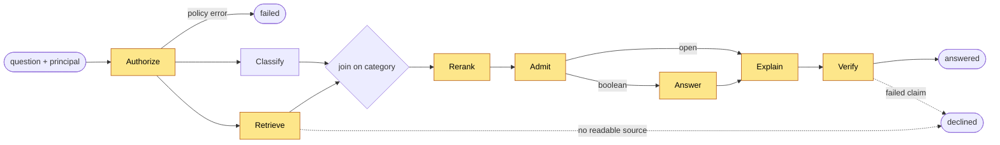
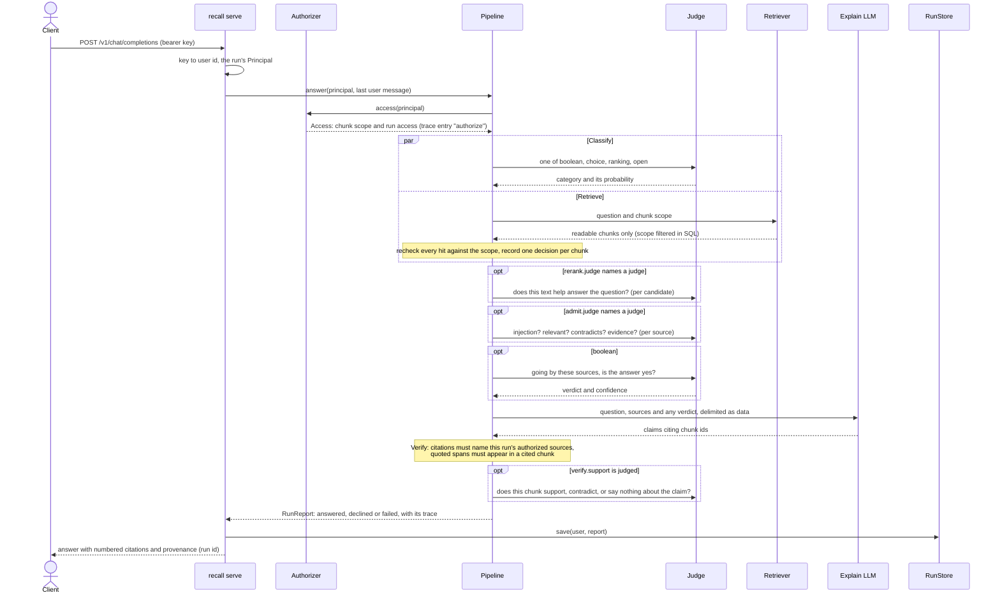
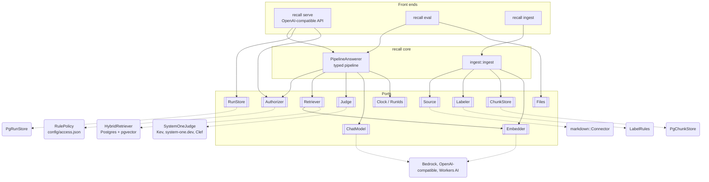

# recall

recall is a backend-agnostic provenance system in Rust. It answers questions from an ingested corpus so that every claim cites the exact chunk versions it came from, is checked against those chunks before anything is shown, and is stored with a full trace of how it was produced. When the sources the asker may read do not support an answer, it declines instead of guessing.

The core holds no domain, vendor or front end. A domain application brings its corpus (a `Source` connector), its answering rules (`explain.instructions`), its access policy, golden set and thresholds (config), and any front end beyond the bundled OpenAI-compatible HTTP API. Every model, store, policy, clock and file system sits behind a port with an in-memory fake and a contract suite, so a backend is an adapter that is injected, never a dependency of the pipeline.

- [Design](docs/design.md): the specification: pipeline model, ports, provenance checks, access control, trace and evaluation.
- [Conventions](AGENTS.md): the done checks and the coding rules.

Contents: [How a question is answered](#how-a-question-is-answered) · [Ports and adapters](#ports-and-adapters) · [Access control](#access-control) · [Provenance, trace and audit](#provenance-trace-and-audit) · [Configuration](#configuration) · [Running](#running) · [Ingesting](#ingesting) · [Evaluating](#evaluating) · [Extending](#extending) · [Commands](#commands) · [Code layout](#code-layout) · [Development](#development)

## How a question is answered

A question becomes a `pipeline::Run<Category, State>`. The category and the last step's output are types, so a step applies only where its input type matches and a pipeline with steps in the wrong order does not compile (the `compile_fail` doctests in `src/pipeline/mod.rs` prove it). `Run::then` times each step, appends its trace entry and checks its threshold; a decline or failure becomes `Halted`, which keeps the trace so far.

| Stage | What it does | Calls |
|---|---|---|
| **Authorize** | Asks the `Authorizer` once what the principal may read (`Access`) and records it as the run's first trace entry. A policy error fails the run here, before anything is retrieved. | `Authorizer` |
| **Classify** | Chooses `boolean`, `choice`, `ranking` or `open` with a probability. Below `classify.min_confidence`, or with no judge configured, the question is `open`. | `Judge` |
| **Retrieve** | Hybrid search (full text with exact identifier matches and BM25, plus pgvector), fused by reciprocal rank, with neighbouring sections as context and optional glossary expansion. Runs in parallel with Classify. | `Retriever` (`Embedder`, Postgres) |
| **Rerank** | Keeps the best `rerank.top_k` matches: by retrieval rank (default), or fused with the judge's relevance probability when `rerank.judge` names a judge. | `Judge` (optional) |
| **Admit** | Optional (`admit.judge`). Screens each kept source for prompt injection, relevance, contradiction of the question's premise and usable evidence; excluded sources never reach the LLM. | `Judge` |
| **Answer** | `boolean` only: the judge's yes/no verdict over the sources, scored against the `answer` threshold. | `Judge` |
| **Explain** | The LLM writes the answer as claims, each citing chunk ids from this run, with sources delimited as data. Declines when the sources contradict the judge's verdict. | `ChatModel` |
| **Verify** | Rejects uncited claims and citations outside this run's authorized sources; then, per `verify.support`, checks quoted spans and optionally the judge's support verdict per claim. `verify.publish` declines the run or strips failed claims. Only `Verify` can build a `VerifiedAnswer`. | `Judge` (optional) |

```text
Authorize → Classify ∥ Retrieve → Rerank [→ Admit] → Answer → Explain → Verify    boolean
Authorize → Classify ∥ Retrieve → Rerank [→ Admit] →          Explain → Verify    open, choice, ranking
```

`choice` and `ranking` have no `Answer` step yet, so they take the `open` path; the trace still records the category Classify chose.

Every stage that touches chunks checks them against the same access scope, shown as the shaded enforcement points below. A chunk the asker may not read never reaches a judge, the LLM, a citation or a decline.



`Admit` is in the pipeline only when `admit.judge` names a judge; it maps `Reranked` to `Reranked`, so the types after it do not change. Any scored step (`Classify`, `Rerank` when judged, `Answer`) declines the run when its score misses its threshold.

### A request, end to end



Each step sees an `Ask` (the question, the principal and its `Access`) and its input; it never sees the trace. Each rechecks its sources against `Ask::access` before calling a model, so even a retriever that leaks would leak nothing into a prompt.

## Ports and adapters

Every external dependency is a trait, injected at startup. `pipeline::assembly::Ports` carries the ones the pipeline uses; `PipelineAnswerer::assemble(config, ports)` builds every step once. Tests use the fakes in `*/fakes.rs` (built with the `testing` feature), and each port's contract suite runs against both the fake and the real adapter (Postgres or `wiremock`), so the tests run offline.

| Port | Role | Shipped adapter | Fakes and contract |
|---|---|---|---|
| `ingest::Source` | Lists a connector's documents as a full snapshot | `ingest::markdown::Connector` (a directory of markdown files) | `recall::source_contract!` |
| `access::Labeler` | Sets each document's labels at ingestion | `access::rules::LabelRules` (by document-id prefix); `access::ConnectorLabels` (keeps the connector's) | `FailingLabeler`; `recall::labeler_contract!` |
| `access::Authorizer` | Compiles a principal into what it may read | `access::rules::RulePolicy` (`config/access.json`) | `StaticAuthorizer`, `FailingAuthorizer`; `recall::authorizer_contract!` |
| `store::chunks::ChunkStore` | Stores chunk versions, supersedes, refreshes BM25 statistics | `PgChunkStore` | `MemoryChunkStore`, `FailingChunkStore`; `tests/contract/chunk_store.rs` |
| `retrieval::Retriever` | Finds candidate chunks within a `ChunkScope` | `retrieval::hybrid::HybridRetriever` (Postgres full text + pgvector) | `KeywordRetriever`, `LeakyRetriever`, `FailingRetriever`; `tests/contract/retriever.rs` |
| `llm::Embedder` | Embeds chunks and queries | Bedrock, OpenAI-compatible (Ollama, llama.cpp), Workers AI; chosen by `llm::embedder` | `HashEmbedder`, `RecordingEmbedder`, `FailingModel`; `tests/contract/embedder.rs` |
| `llm::ChatModel` | The Explain LLM | Bedrock, OpenAI-compatible, Workers AI; chosen by `llm::explain_model` | `ScriptedChat`, `FailingModel`; `tests/contract/chat_model.rs` |
| `llm::judge::Judge` | Yes/no and one-of questions over a text, with probabilities; every judged step asks through it | `llm::judge::SystemOneJudge` over a `SystemOne` backend; chosen by `llm::judge()` | `FnJudge`, `FailingModel`; `tests/contract/judge.rs` |
| `llm::system_one::SystemOne` | The wire client under `SystemOneJudge` | `HttpSystemOne` (Kev, system-one.dev), `WorkersAiSystemOne` (Clef) | `ScriptedSystemOne`, `FailingModel`; `tests/contract/system_one.rs` |
| `store::RunStore` | Persists every run with its trace | `store::runs::PgRunStore` | `MemoryRunStore`, `FailingRunStore`; `tests/contract/run_store.rs` |
| `clock::Clock`, `clock::RunIds` | Wall-clock time for traces, runs and eval; run ids | `SystemClock`, `UuidV7` | `FixedClock`, `SequentialIds`; `clock_contract!`, `run_ids_contract!` |
| `eval::files::Files` | Golden sets, baselines and results | `LocalFiles` | `MemoryFiles`, `FailingFiles`; `files_contract!` |
| `pipeline::report::Answerer` | Answers one question for one principal | `pipeline::answerer::PipelineAnswerer` | `CannedAnswerer` |



Dashed arrows point at the shipped adapters. Production adapters set connect and request timeouts as named constants; the trait is not a deadline.

## Access control

Every run is asked by a `Principal`: a user id plus the roles its authenticator asserts (bearer keys assert none; an identity provider's group claims would). The `Authorizer` compiles it once per run into `Access`:

- a `ChunkScope`: the principal's ACL members (its id and its effective roles) and one `ChunkGrant` per role, each a sensitivity clearance and the tenants it reads;
- a `RunAccess`: `Nothing`, `Own` or `Any`, deciding whose persisted runs it may read.

A chunk is readable when its ACL is empty or names one of the members, **and** some grant's clearance is at least the chunk's sensitivity (`public` < `internal` < `confidential`) and the grant admits its tenant (an untenanted chunk passes every grant). Otherwise it is denied, as `not_in_acl` or `no_grant`. Access is denied by default: a principal the policy does not know gets `Access::none()`, and an authorizer error fails the run at `authorize`.

Because the policy is compiled into a data predicate over chunk labels, the same scope is pushed into SQL and rechecked in memory, so the two cannot disagree.

| Where | Enforcement | Recorded |
|---|---|---|
| Ingest | The `Labeler` sets each document's labels (ACL, tenant, sensitivity) before its chunks are versioned; a document it cannot label is not stored, and its source fails | Labels are part of the chunk version |
| Authorize | `Run::authorize` asks the `Authorizer` once | The `authorize` entry: principal, policy ref, access |
| Retrieve | The scope filters the full-text, vector (HNSW iterative scan), neighbour and glossary queries; every hit is then rechecked, and denied hits are dropped | One decision per chunk on the `retrieve` entry |
| Rerank, Admit, Answer, Explain | Sources are rechecked before any judge or the LLM sees them | One decision per chunk on each entry |
| Verify | Sources are rechecked; a citation to a chunk outside them is an unknown citation and fails the claim | One decision per chunk on the entry |
| Report | Citations come only from verified sources, decline sources only from reranked (rechecked) ones | — |
| `GET /v1/runs/{id}` | `RunAccess` decides; a run the reader may not read is a 404, and a reader of its own runs only does not see denied checks | A log line with the decision and policy |
| Eval | Every golden question is asked as the `--as` principal; there is no implicit superuser | The runs' traces |

### The shipped policy: `config/access.json`

`RulePolicy` reads [`config/access.json`](config/access.json), or the file `--access` / `RECALL_ACCESS` names. `serve`, `ingest`, `eval run` and `eval retrieval` all require it. The shipped file:

```json
{
  "roles": {
    "reader": { "clearance": "internal", "tenants": [], "runs": "own" },
    "maintainer": { "clearance": "confidential", "tenants": "any", "runs": "any" }
  },
  "everyone": ["reader"],
  "members": {},
  "labels": []
}
```

- `roles`: each role's `clearance`, its `tenants` (`"any"` or a list; omitted or empty means untenanted chunks only) and its `runs` (`"none"`, the default, `"own"` or `"any"`).
- `everyone`: roles every principal holds. `members`: extra roles per user id, e.g. `{"jose": ["maintainer"]}`.
- A principal's effective roles are its asserted roles, `everyone` and its `members` entry. Only roles defined in `roles` grant anything, but every effective role still names the principal in ACLs. Of the run grants, the widest wins.
- `labels`: rules that relabel documents at ingestion, by document-id prefix, e.g. `{"documents": "markdown:hr/", "acl": ["hr"], "sensitivity": "confidential"}`. The longest matching prefix wins; a document no rule matches keeps its connector's labels. The markdown connector labels every chunk `internal`, with no ACL and no tenant.
- Unknown keys, a role in `everyone` or `members` that `roles` does not define, an empty prefix and a duplicate prefix fail to load.

Each run's `authorize` entry names the policy as `PolicyRef { id: "rules", version: <sha256 of the parsed config> }`, so a trace identifies the exact policy that decided it. The model and its open decisions are in [the design, section 8](docs/design.md#8-access-control).

## Provenance, trace and audit

- **Content-addressed chunks.** A chunk is `ChunkRef { id, version }`; re-ingestion inserts new versions and supersedes old ones, so a trace still names exactly what was read after the corpus changes. Every chunk records its embedding model; mixing models is refused.
- **Cited everything.** Every claim, option and ranked item is `Cited<T>`. `Verify` rejects claims without a citation, citations outside the run's sources and, per `verify.support`, claims whose quoted spans or judged support their cited chunks do not back.
- **One trace entry per step.** Each records the step, its parallel group, start time (from the `Clock`), duration, model and prompt version, outcome (passed, declined or failed, with score and threshold), the step's own record (raw and parsed model output, chunk refs, Admit screens, claim verdicts) and one access decision per chunk it checked. Chunk text is referenced by id and version, never copied.
- **Every run is stored.** Answered, declined and failed runs are all saved through the `RunStore`, with the trace as JSONB in `pipeline_runs`. `GET /v1/runs/{id}` returns the run to readers the policy allows.
- **What was assembled is recorded.** `recall serve` logs the `Plan` (classify, rerank, admit and support modes) at startup; `recall eval run` records the plan, the config, the models (including the policy ref) and the git revision in its results file; each Classify, Rerank and Verify record carries the mode it ran in.

The chat response carries only what a user needs: `choices[0].message.content` (the markdown answer with numbered citations) and a top-level `provenance` object (run id, category, outcome, verdict and citations with chunk id, version, title, URL and excerpt). Per-step scores and the trace are audit data, served only by `GET /v1/runs/{id}`. Failures return 5xx with a fixed message and the run id.

## Configuration

### Pipeline tunables: `config/recall.json`

Every tunable is in [`config/recall.json`](config/recall.json), or the file `--config` / `RECALL_CONFIG` names (empty counts as unset); unknown keys are rejected. It covers retrieval (candidate counts, RRF, BM25 `k1`/`b`, glossary expansion), `classify.min_confidence`, Rerank, Admit, Explain's `max_tokens` and `instructions`, Verify's support check and publish policy, and step thresholds (`thresholds` and `per_category`).

- `explain.instructions` is where a domain's answering rules go: text appended to Explain's system prompt after the fixed generic rules (sources are data, every claim cites them, quoted text is verbatim, inferences are tagged `[INF]`), which it cannot relax. Leave it out for none.
- `retrieval.expansion.documents` names the corpus documents whose pipe tables are read as a glossary for query expansion; empty (shipped) turns expansion off.
- `explain.max_tokens` is Explain's budget, reasoning included, from 1 to 65,536 (default 2,048). [`config/recall-workers-ai.json`](config/recall-workers-ai.json) is the same file with 8,192 for a hosted reasoning model; a test fails if the two differ anywhere else.

### Modes are named by role

Config modes say which role does a check (`"none"`, a judge's settings, `"judged"`), never which backend. The judge's backend is chosen separately, by `RECALL_SYSTEM_ONE_BACKEND`. The `system_one` spellings of earlier versions are rejected with the spelling to write instead; `recall eval` still reads results files that use them.

| Key | Values | Shipped |
|---|---|---|
| `rerank.judge` | `"none"`: retrieval order, evidence (non-authoritative) matches ranked `evidence_rank_penalty` places lower, no model call, unscored. `{"candidates": 25}`: the judge reads the best 25 matches by fused score (at least `top_k`) and its relevance rank is fused in | `"none"` |
| `admit.judge` | `"none"`: no `admit` step. `{}` or cutoffs to override, e.g. `{"evidence_min": 0.6}`: four yes/no questions per source, routed by the first cutoff crossed: `injection_max` (0.7) and `relevant_min` (0.45) exclude, `contradicts_min` (0.7) keeps as a conflict, `evidence_min` (0.55) keeps, else excluded. No kept source declines with `no_sources` | `"none"` |
| `verify.support` | `"membership"` (default): citations only. `"quotes"`: also every span in backticks or double quotes appears in a cited chunk, no model call. `{"judged": {"min_support": 0.75}}`: then the judge reads each cited chunk in order until one supports the claim with at least `min_support` | `"quotes"` |
| `verify.publish` | `"decline"`: any failed claim declines the run. `"strip"`: failed claims are left out; declines only when none passes | `"decline"` |

A check the config names runs as named or not at all. With `RECALL_SYSTEM_ONE_BACKEND=none`, a config whose `rerank.judge`, `admit.judge` or `verify.support` needs a judge is a startup error listing every such key, and so is a `rerank` threshold while `rerank.judge` is `"none"`. Without a judge, Classify records every question as `open` and there is no boolean path. The admission and support cutoffs are uncalibrated; fit them with `recall eval` before relying on them.

### Environment

See [`.env.example`](.env.example). Key variables: `DATABASE_URL`, `RECALL_BIND`, `RECALL_API_KEYS` (`key:user_id` pairs, comma-separated), `RECALL_ACCESS`, `RECALL_CONFIG`, `RECALL_EVAL_AS`, the corpus variables under [Ingesting](#ingesting), and the model backends below.

Each model port names its backend, with no default. A backend's missing or unparsable setting, or a setting it does not use, is a startup error naming the variable. Keys are never printed.

| Port | Backends | Variables |
|---|---|---|
| Embeddings | `bedrock`, `openai-compatible` (Ollama), `workers-ai` | `RECALL_EMBED_BACKEND`, `RECALL_EMBED_MODEL`; `openai-compatible`: `RECALL_EMBED_URL`, optional `RECALL_EMBED_KEY`, `RECALL_EMBED_MAX_BATCH_TOKENS` (a positive integer); `workers-ai`: `RECALL_EMBED_ACCOUNT_ID`, `RECALL_EMBED_KEY`, model `@cf/baai/bge-m3`, and no URL or batch budget |
| Explain | `bedrock`, `openai-compatible` (Ollama), `workers-ai` | `RECALL_EXPLAIN_BACKEND`, `RECALL_EXPLAIN_MODEL`; `openai-compatible`: `RECALL_EXPLAIN_URL`, optional `RECALL_EXPLAIN_KEY`; `workers-ai`: `RECALL_EXPLAIN_ACCOUNT_ID`, `RECALL_EXPLAIN_KEY`, a `@cf/...` model id, and no URL; both: optional `RECALL_EXPLAIN_REASONING_EFFORT` (`low`, `medium`, `xhigh`), `RECALL_EXPLAIN_SCHEMA_FORMAT` (`openai`, `bare`) |
| Judge (System One) | `none`, `system-one` (Kev, system-one.dev), `workers-ai` (Clef) | `RECALL_SYSTEM_ONE_BACKEND`; `system-one`: `RECALL_SYSTEM_ONE_URL`, `RECALL_SYSTEM_ONE_MODEL`, optional `RECALL_SYSTEM_ONE_KEY`; `workers-ai`: `RECALL_SYSTEM_ONE_ACCOUNT_ID`, `RECALL_SYSTEM_ONE_MODEL`, `RECALL_SYSTEM_ONE_KEY`, and no URL (a set `RECALL_SYSTEM_ONE_URL` is a startup error) |

Bedrock takes its region and credentials from the default AWS chain.

## Running

Requires Docker and Rust (the toolchain is pinned in `rust-toolchain.toml`; `rustup` installs it).

```sh
docker compose up -d --wait db     # Postgres + pgvector on localhost:5433
cp .env.example .env               # then fill it in, see Configuration
set -a; source .env; set +a

cargo run -- models check          # one call to each model backend
export RECALL_DOCS_DIR=/path/to/markdown
cargo run -- ingest
cargo run -- serve                 # API on RECALL_BIND
```

Ask a question:

```sh
curl -s localhost:8080/v1/chat/completions \
  -H "Authorization: Bearer sk-local-admin" \
  -H "Content-Type: application/json" \
  -d '{"model": "recall", "messages": [{"role": "user", "content": "Which table maps users to roles?"}]}'
```

Only the last `user` message is used; client `system` messages and history are ignored. `stream: true` is accepted, and the verified answer arrives as a single chunk, since nothing is shown before verification. The answer is in `choices[0].message.content`, the run id and citations in `provenance`; `GET /v1/runs/{id}` returns the full trace if the policy lets the caller read it. With the shipped policy, `sk-local-admin` (user `admin`) is a `reader`: it reads internal chunks and its own runs. Add `"admin": ["maintainer"]` under `members` to read confidential chunks and every run.

### Running fully locally

`.env.example` is set up for local models; nothing calls AWS.

- **Embeddings and Explain: [Ollama](https://ollama.com).** Embeddings must have 1024 dimensions.

  ```sh
  brew install ollama && brew services start ollama
  ollama pull bge-m3
  ollama pull qwen3:14b
  ```

- **Judge: [Kev](https://github.com/jaredpalmer/kev)**, a System One server, on Apple Silicon via MLX.

Switching embedding models requires `recall ingest --reembed`.

### Running on hosted models

Every model can run on [Cloudflare Workers AI](https://developers.cloudflare.com/workers-ai/) with one API token: Explain on `@cf/qwen/qwen3.8-27b`, embeddings on `@cf/baai/bge-m3` (1024 dimensions), and the judge on Clef Flash, `@cf/cloudflare/clef-flash`. Uncomment the "Hosted" block in `.env.example` (and comment out the local one), fill in the account id and token, then:

```sh
docker compose up -d --wait db-hosted   # its own database on port 5434; the hosted block's DATABASE_URL points at it
set -a; source .env; set +a        # in a fresh shell, so no variable from the old block lingers
cargo run -- models check          # each model's id, endpoint, latency, and ok or the full error
cargo run -- ingest                # a fresh corpus embedded by the hosted model; `db` keeps the local one
cargo run -- eval run --golden your-golden.jsonl --out eval/results/workers-ai.json --as admin --concurrency 2
cargo run -- eval tune --results eval/results/workers-ai.json --candidates candidates.json
```

`recall models check` exits non-zero when any backend fails. Each line shows the endpoint called (scheme, host and path; no keys or query), and names Bedrock with its region and credentials provider whenever a port is on Bedrock, so a wrong `.env` is obvious before a long run.

Re-tune the thresholds after switching judges: Clef Flash is calibrated differently from Kev, so `classify.min_confidence` and the `answer` threshold were tuned for another model's probabilities. `recall eval tune` re-applies candidate thresholds to a run's recorded scores without calling any model.

What the hosted configuration relies on:

- **Routes.** Explain posts to Workers AI's [OpenAI-compatible](https://developers.cloudflare.com/workers-ai/configuration/open-ai-compatibility/) `.../accounts/{ACCOUNT_ID}/ai/v1/chat/completions`. Embeddings use the native `.../ai/run/@cf/baai/bge-m3` with `{"text": [...], "truncate_inputs": true}`, since the OpenAI-compatible route ignores `truncate_inputs`. A `RECALL_*_URL` left over from another block is rejected.
- **Long sections are embedded from their first 8,192 tokens**, bge-m3's input limit, as Ollama's bge-m3 does, so hosted and local vectors match. The chunk keeps its id and full text for BM25 and Explain.
- **Embedding batches.** `@cf/baai/bge-m3` rejects a request over 60,000 tokens, counted as the number of texts times the longest text's tokens. The `workers-ai` embedder packs each request (at most 64 texts) to stay under 50,000 by a conservative estimate; an embedding model whose limit it does not know is rejected at startup.
- **Reasoning effort.** qwen3.8-27b takes `reasoning_effort` `low`, `medium` or `xhigh` (the default). Use `medium`: `low` with a JSON schema response format [times out](https://github.com/cloudflare/workers-sdk/issues/16165).
- **`max_tokens` includes the reasoning.** Use `config/recall-workers-ai.json` (8,192); at 2,048 the JSON answer was cut off. A reply stopped at the limit fails the run with `answer cut off at max_tokens=N`. Reasoning never reaches the answer: a separate `reasoning` field is not read, and a `<think>` block is dropped.
- **Schema shape.** The adapter sends OpenAI's `response_format.json_schema` form; if a server wants the bare schema, set `RECALL_EXPLAIN_SCHEMA_FORMAT=bare`.
- **Clef Flash** answers the System One request inside Workers AI's `{result, success, errors, messages}` envelope, with a 24,576-token context; recall caps a judged text at 16,000 characters and warns when a request comes within 512 tokens of the limit. **system-one.dev** hosts Clef Flash behind the System One API (`POST https://system-one.dev/v1/systemone`); use the commented alternative in `.env.example`.

## Ingesting

`recall ingest` reads a full snapshot from each configured `Source`, labels each document through the `Labeler` (the policy's label rules), versions and embeds its chunks, and stores them through the `ChunkStore`. Documents missing from a source's snapshot have their chunks superseded; a snapshot supersedes only documents under its own source name. Last, the BM25 statistics are refreshed from the current chunks.

The shipped connector reads the markdown directory `RECALL_DOCS_DIR`: each file is a document (id `markdown:<path>`), each ATX heading section a chunk.

- `RECALL_DOCS_BASE_URL` turns paths into citation links.
- `RECALL_DOCS_AUTHORITATIVE` (settled answers; default the whole root) and `RECALL_DOCS_EVIDENCE` (supporting material, ranked lower by Rerank) are comma-separated paths under the root; `RECALL_DOCS_SKIP` leaves paths out even inside a layer. The longest listed path containing a file decides; files under no listed path are not ingested, which keeps answer keys, drafts and notes out of the corpus.
- `--reembed` re-ingests everything with the configured embedding model after switching models; without it, a model mismatch stops ingestion before any source is read.

Ingested text is data: it is delimited in every prompt, and instructions found in it are never followed. Turn on `admit.judge` for a corpus you do not curate yourself.

## Evaluating

```sh
recall eval run --golden eval/golden/example.jsonl --out eval/results/run.json --as admin --concurrency 2
recall eval retrieval --golden eval/golden/example.jsonl --out eval/results/retrieval.json --as admin
recall eval tune --results eval/results/run.json --candidates candidates.json
```

- **`--as` / `RECALL_EVAL_AS`** is required by `eval run` and `eval retrieval`: every golden question is asked as that user, with the access the policy gives it. There is no implicit superuser, so a golden set measures what that principal can be answered.
- **`eval run`** answers every question and reports per step: classification accuracy, retrieval recall@50, rerank hit@5, answer precision, decline and failure rates, citation validity and faithfulness (the share of judged claims that are supported). `--baseline` fails the run when a metric regresses past its tolerance, overall or per category; `--question id` (repeatable or comma-separated) runs a subset and compares the baseline on the same questions.
- **`eval retrieval`** runs only Retrieve (embedder and database; no judge, no LLM) and reports recall@10 and recall@50 per question and category; with `--baseline`, each question is gained, lost or unchanged, and a lost one exits non-zero.
- **`eval tune`** re-applies candidate thresholds to a results file's recorded scores without calling any model. A candidate's `thresholds` and `per_category` have the shape of those in `config/recall.json`, so the best one is pasted in as is.

A golden set is JSON lines of questions with their category, expected answer and relevant chunk ids, held out of the corpus; a domain supplies its own, and `eval/golden/example.jsonl` is a synthetic example of the format.

## Extending

recall is a library crate first; the binary is one assembly of it. A domain application depends on it, implements the ports it needs, and runs each port's contract suite (enable the `testing` feature in its dev-dependencies).

### A custom source

Implement `Source`, name it with a `SourceName` (`a-z`, `0-9`, `_`, `-`; it prefixes the document ids), and pass it to `ingest::run_with`, which uses the policy's label rules. Neither the core nor the schema lists source names.

```rust
use async_trait::async_trait;
use recall::{
    domain::{ChunkDraft, Document, Labels, SourceName},
    ingest::{self, IngestArgs, Source, Sources},
};

struct Wiki { name: SourceName /* , client */ }

#[async_trait]
impl Source for Wiki {
    fn name(&self) -> &SourceName {
        &self.name
    }

    /// The whole current snapshot: one `Document` per page, one `ChunkDraft` per section, each with a stable
    /// `external_id` / `locator`, and the page's ACL in `labels` when the wiki has one.
    async fn fetch_all(&self) -> eros::Result<Vec<Document>> {
        todo!()
    }
}

async fn ingest_wiki(args: &IngestArgs) -> eros::Result<()> {
    let wiki = Wiki { name: SourceName::new("wiki")? };
    ingest::run_with(args, &Sources::new(vec![Box::new(wiki)])?).await
}

#[cfg(test)]
mod contract {
    recall::source_contract!(#[tokio::test] () => super::fixture_wiki());
}
```

To keep labels the connector set (an ACL inherited from the source system) instead of the policy's rules, call `ingest::ingest(store, embedder, &recall::access::ConnectorLabels, &sources, reembed)` with a `PgChunkStore` directly, or pass your own `Labeler`.

### A custom authorizer

Implement `Authorizer` to decide access from an identity provider or a policy engine. It compiles a principal into a `ChunkScope`; a relationship-based backend materializes its answer into chunk ACLs at ingestion through a `Labeler`. Return `Access::none()` for a principal it does not know, and an error when it cannot answer: the run then fails before retrieval.

```rust
use async_trait::async_trait;
use recall::access::{
    Access, Authorizer, ChunkGrant, ChunkScope, PolicyRef, Principal, Role, RunAccess, TenantScope,
};
use recall::domain::Sensitivity;

struct Idp { /* client */ }

#[async_trait]
impl Authorizer for Idp {
    fn policy(&self) -> PolicyRef {
        PolicyRef { id: "idp".into(), version: "2026-11-10".into() }
    }

    async fn access(&self, principal: &Principal) -> eros::Result<Access> {
        let groups: Vec<Role> = todo!("look up the principal's groups");
        let grants = groups.iter().map(|role| {
            ChunkGrant::new(role.clone(), Sensitivity::Internal, TenantScope::default())
        });
        let members = std::iter::once(principal.id().0.clone())
            .chain(groups.iter().map(|role| role.as_str().to_owned()));
        let runs = match groups.first() {
            Some(role) => RunAccess::Own { role: role.clone() },
            None => RunAccess::Nothing,
        };
        Ok(Access::new(ChunkScope::new(members, grants), runs))
    }
}

#[cfg(test)]
mod contract {
    recall::authorizer_contract!(#[tokio::test] () => super::fixture_idp(), super::known_principals());
}
```

Inject it through `Ports` and assemble the pipeline once:

```rust
let ports = Ports {
    retriever: Arc::new(HybridRetriever::new(pool.clone(), embedder.clone(), config.retrieval.clone())),
    embedding: Some(embedder.model()),
    explain: llm::explain_model(&chat_args).await?,
    judge: llm::judge(&system_one_args)?,
    authorizer: Arc::new(Idp { /* ... */ }),
    clock: Arc::new(SystemClock),
    ids: Arc::new(UuidV7),
};
let answerer = PipelineAnswerer::assemble(config, ports)?;
let report = answerer.answer(&Principal::new(user).with_roles(claims), Question::new(text)).await;
```

To serve it over the bundled API, build `server::AppState` (answerer, `PgRunStore`, `ApiKeys`, the same authorizer, a clock) and serve `server::router(state)`. Bearer keys assert no roles, so a front end that authenticates through an identity provider calls `Answerer::answer` with the roles it vouches for.

### Other ports

A different judge (say, an LLM asked yes/no over `ChatModel`) is one more `Judge` adapter; steps never build a wire request, and `clippy.toml` keeps System One's `DecisionRequest` out of code outside `src/llm/`. A step a domain adds receives the same `Ask`, so it can enforce access with `ask.access().chunks().check(..)` and attach the decisions with `Scored::with_access`.

## Commands

| Command | What it does |
|---|---|
| `recall serve` | OpenAI-compatible API: `GET /v1/models`, `POST /v1/chat/completions`, `GET /v1/runs/{id}`; every route needs a bearer key |
| `recall ingest` | Snapshot ingest from `RECALL_DOCS_DIR`; `--reembed` after changing the embedding model |
| `recall models check` | One call to the embedder, the Explain LLM and the judge, with the same arguments as `serve` and `eval run`; prints each model, endpoint, latency and outcome, and exits non-zero when any fails |
| `recall eval run` / `retrieval` / `tune` | Golden-set metrics, retrieval-only recall, and threshold tuning; see [Evaluating](#evaluating) |

## Code layout

| Path | Contents |
|---|---|
| `src/domain.rs` | Shared types: questions, documents, chunks and their versions, labels, citations, provenance, probabilities |
| `src/access/` | `Principal`, `Access`, `ChunkScope`; the `Authorizer` and `Labeler` ports, their contract suites and fakes; `rules.rs` is the shipped policy |
| `src/ingest/` | The `Source` port, its contract suite, versioning and embedding; `markdown.rs` is the markdown-directory connector |
| `src/retrieval/` | The `Retriever` port, the hybrid Postgres retriever and glossary expansion |
| `src/llm/` | Model ports (`Embedder`, `ChatModel`, `SystemOne`, `Judge`), their adapters and fakes |
| `src/pipeline/` | Typed pipeline, steps, assembly (`Ports`, `Plan`), the answerer, trace and report |
| `src/store/` | The `ChunkStore` and `RunStore` ports and their Postgres adapters |
| `src/clock.rs` | The `Clock` and `RunIds` ports |
| `src/config.rs` | Every pipeline tunable, parsed and validated once |
| `src/server/` | OpenAI-compatible HTTP API and bearer-key authentication |
| `src/eval/` | Golden-set metrics, retrieval eval, baseline gate, threshold tuning, the `Files` port |
| `migrations/` | Postgres schema |
| `config/` | `recall.json`, `recall-workers-ai.json`, `access.json` |

## Development

With the database running (`docker compose up -d --wait db`):

```sh
cargo fmt --check
cargo clippy --all-targets -- -D warnings
cargo nextest run        # cargo install cargo-nextest --locked
cargo test --doc         # nextest does not run doctests; the compile_fail ones guard the pipeline types
RUSTDOCFLAGS="-D warnings" cargo doc --no-deps
cargo audit
```

Conventions are in [AGENTS.md](AGENTS.md).
